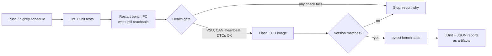

# bench-ci-automation

[](https://github.com/prsricharan/bench-ci-automation/actions/workflows/ci.yml)

CI/CD automation for **hardware-in-the-loop (HIL) test benches**: reboot the bench PC, gate on hardware health, flash the ECU build, verify the version, then run the pytest suite — all from a pipeline, with nobody at the bench.

A **simulated bench backend** runs the same pipeline without hardware, so every push is tested end to end on GitHub Actions, and faults (dead ECU, low supply voltage, failed flash) can be injected to prove the gates work.

> This is a reference implementation built for my portfolio. It contains no proprietary code; the real-hardware backend is a documented integration point to adapt to a specific rig.

## The problem

Overnight regression on physical benches tends to fail for reasons that have nothing to do with the software under test: a bench PC that needs a reboot, a power supply left at the wrong voltage, a CAN adapter that dropped off, an ECU still running yesterday's build. Each one wastes a night of test time and a morning of triage.

## What the pipeline does



| Step | Checks | Fails when |
|---|---|---|
| **restart** | Bench PC back online after reboot | Not reachable within `reboot_timeout_s` |
| **health** | PSU voltage in range, CAN interface up, ECU heartbeat, active DTCs | Any check outside limits |
| **flash** | Image flashes, ECU reports the expected version | Flash aborts or version mismatch |
| **bench tests** | pytest suite tagged `@pytest.mark.bench` | Any test fails |

Each step writes a JSON report and exits non-zero on failure, so a bad bench stops the pipeline **before** the test stage instead of producing a night of false failures.

## Project layout

```
benchctl/
  cli.py              # benchctl restart | health | flash | prepare
  steps.py            # restart, health gate, flash-and-verify
  config.py           # bench inventory (YAML)
  drivers/
    base.py           # driver interface every backend implements
    simulated.py      # no-hardware backend with fault injection
    winrm.py          # real Windows bench PCs over WinRM
config/benches.yaml   # one entry per bench, matched to a runner tag
tests/unit/           # logic tests (simulated backend)
tests/bench/          # smoke tests that run ON a prepared bench
.gitlab-ci.yml        # real benches on self-hosted runners
.github/workflows/    # same flow on the simulator
```

## Run it locally

```bash
pip install -e ".[dev]"

# unit tests
pytest -m "not bench"

# full bench flow on the simulator
mkdir -p build && head -c 1024 /dev/zero > build/ecu_app_1.4.2.bin
export BENCH_NAME=sim-bench
benchctl prepare --image build/ecu_app_1.4.2.bin --version 1.4.2
pytest -m bench
```

Example output:

```
[PASS] restart (0.2s)
    ok bench_pc_online: back online after ~0s
[PASS] health (0.0s)
    ok psu_voltage: 13.50 V (allowed 11.5-14.5 V)
    ok can_interface: can0 up
    ok ecu_heartbeat: ECU_A responding
    ok active_dtcs: 0 active
[PASS] flash (0.0s)
    ok flash: flashed ecu_app_1.4.2.bin
    ok version_match: ECU reports 1.4.2, expected 1.4.2
report: reports/prepare.json
```

### Inject a fault

```bash
BENCH_SIM_FAULTS=no_heartbeat benchctl health
```

```
[FAIL] health (0.0s)
    ok psu_voltage: 13.50 V (allowed 11.5-14.5 V)
    ok can_interface: can0 up
    !! ecu_heartbeat: ECU_A silent for 2.0s
    ok active_dtcs: 0 active
```

Available faults: `unreachable`, `psu_low`, `can_down`, `no_heartbeat`, `dtc`, `flash_fail`, `bad_version`.

## Running on real benches (GitLab)

1. Install a GitLab runner on each bench PC and tag it with the bench name (e.g. `hil-bench-01`).
2. Add the bench to `config/benches.yaml` with `backend: winrm`.
3. Put a small helper (`bench_agent.py`) on the bench that wraps your power supply, CAN adapter and flashing tool — see `benchctl/drivers/winrm.py` for the commands it needs to answer.
4. Set `BENCH_WINRM_USER` / `BENCH_WINRM_PASSWORD` as **masked** CI/CD variables.
5. Create a pipeline schedule for the nightly run.

`resource_group` in `.gitlab-ci.yml` ensures two pipelines never use the same bench at once.

## Adding a new hardware backend

Implement `BenchDriver` in `benchctl/drivers/base.py` (eight methods: reboot, reachability, PSU voltage, CAN status, heartbeat, DTCs, flash, version) and register it in `make_driver()`. The pipeline steps and tests don't change.

## License

MIT
